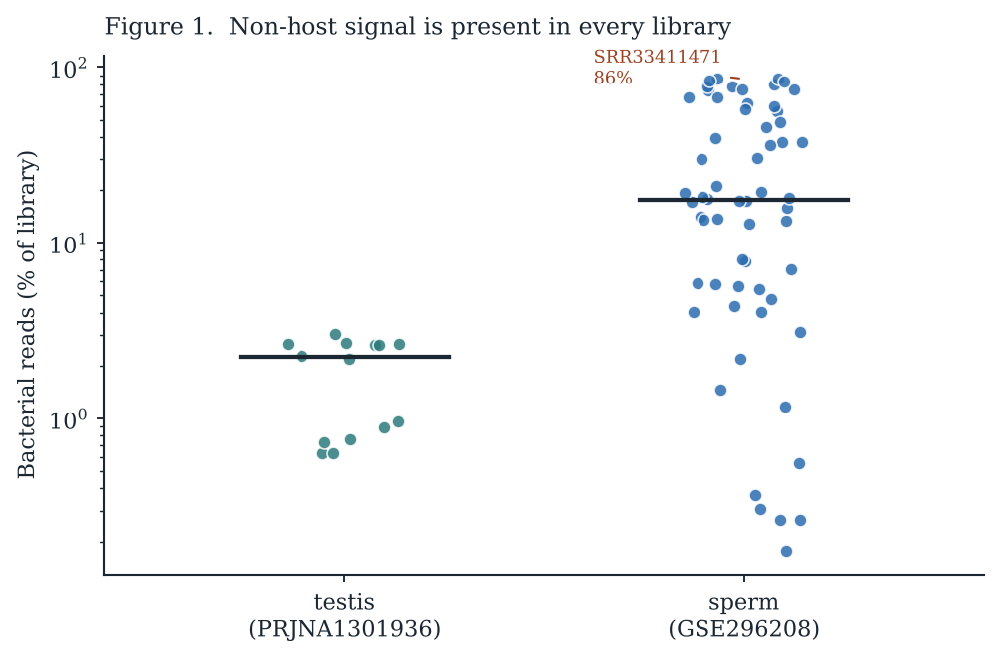
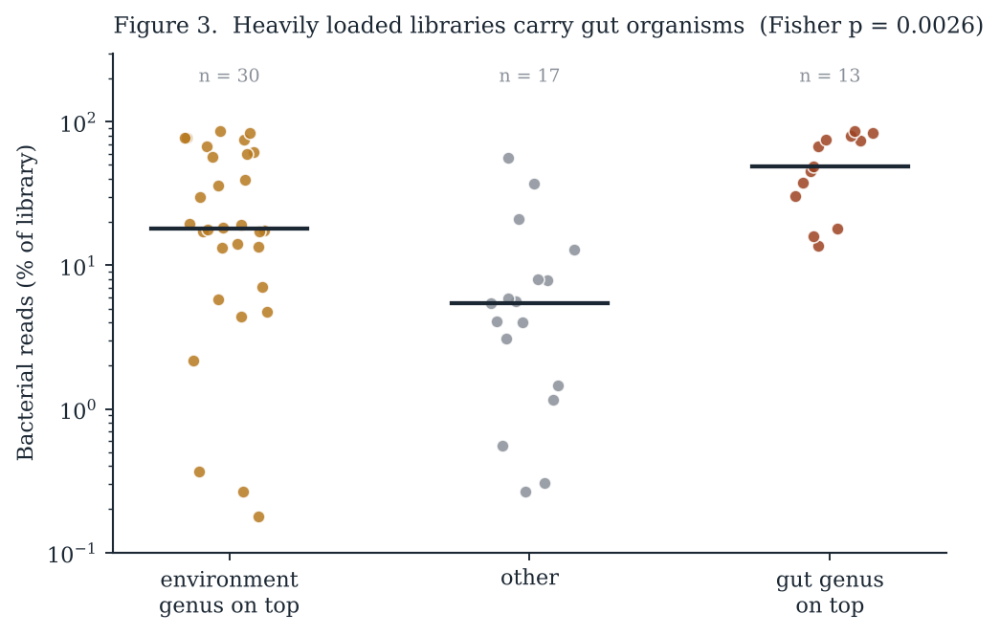
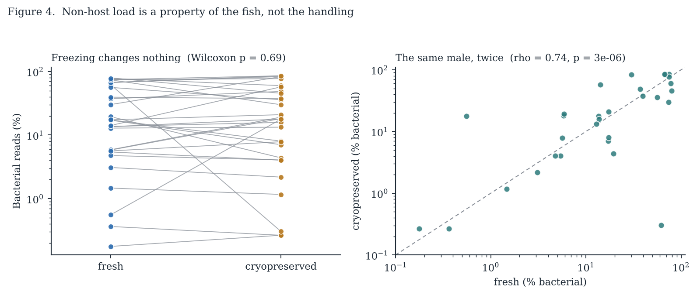
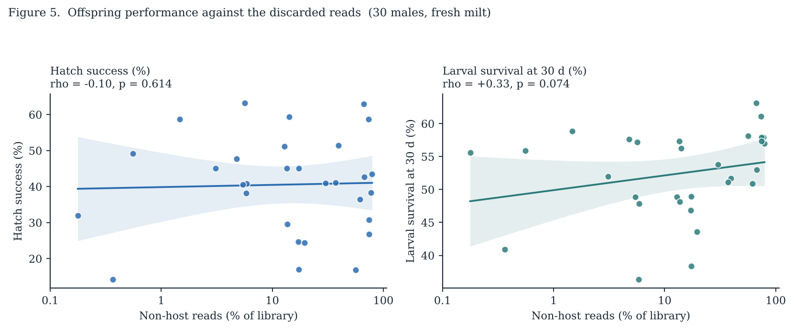

# Non-host reads in blue catfish reproductive tissue

**Week 12, Data Reuse project.** Public data only. Two deposited *Ictalurus furcatus* RNA-seq studies, 74 runs.

**[Open the report](docs/index.html)** · [Reproduce](#reproducing-this) · [Limitations](#limitations)

An RNA-seq experiment is run to measure one animal's gene expression. Reads that do not map to that animal are dropped at the first step of every pipeline and never looked at again. This project asks what is in that discarded fraction, whether it differs between fish, and whether it relates to how the offspring do.

## The two studies

| BioProject | Tissue | Runs | Design |
|---|---|---:|---|
| PRJNA1301936 | Testis | 14 | Spermatogenesis and testicular expression |
| PRJNA1258209 / GSE296208 | Sperm | 60 | 30 males, fresh and cryopreserved |

Both were deposited to answer questions about fish gene expression. Neither was submitted with the non-host fraction in mind.

## Findings

**1. Every library contains non-host sequence, and the two tissues differ.**

| Study | n | Min % | Median % | Max % |
|---|---:|---:|---:|---:|
| Testis | 14 | 0.63 | 2.24 | 3.04 |
| Sperm | 60 | 0.18 | **17.61** | **85.59** |

Mann–Whitney p = 1.7 × 10⁻⁵. Viruses and fungi are negligible everywhere. Sperm libraries span a **483-fold range** within one species and one tissue. One run, `SRR33411471`, is 85.6% bacterial against 4.7% metazoan.



**2. It is not one organism repeated.**

Sequence introduced by something all samples passed through should show the same organisms everywhere. It does not: the most frequent dominant genus in sperm holds the top slot in only 13 of 60 libraries, across 14 different genera.

**3. The identity of the organism depends on how much there is.**

| | Environment genus on top | Gut genus on top | Other |
|---|---:|---:|---:|
| ≤ 30% bacterial | 19 | 3 | 15 |
| **> 30% bacterial** | 11 | **10** | 2 |

Fisher exact **p = 0.0026**. Gut-topped libraries carry a median 49% bacterial reads; environment-topped, 18%. Light libraries are headed by *Stenotrophomonas*, *Pseudomonas*, *Staphylococcus*, *Cutibacterium*; heavy ones by *Parabacteroides*.



**4. The quantity belongs to the fish, not the handling.**

Each of the 30 males was sequenced twice, fresh and after cryopreservation.

| Comparison | Statistic | Result |
|---|---|---|
| Fresh vs cryo, paired | Wilcoxon p = 0.685 | No difference |
| Fresh vs cryo, within male | **ρ = +0.742, p = 2.6 × 10⁻⁶** | Strongly correlated |

Two libraries prepared separately from the same fish agree on how much of the library is not fish. The predictor is therefore measured twice rather than once.



**5. Against offspring performance.**

Crosses were made with fresh milt, so the 30 fresh libraries are the analysis. The cryopreserved libraries come from the same males and are tabulated alongside as a repeat measurement of the predictor; they are not a second test.

| Trait | Libraries | n | ρ | p | Slope per 10× | r² |
|---|---|---:|---:|---:|---:|---:|
| Hatch success | fresh | 30 | −0.096 | 0.614 | +0.62 | 0.001 |
| Larval survival, 30 d | fresh | 30 | **+0.331** | 0.074 | +2.24 | 0.060 |
| Hatch success | cryo (repeat) | 30 | +0.183 | 0.334 | +4.16 | 0.054 |
| Larval survival, 30 d | cryo (repeat) | 30 | **+0.401** | **0.028** | +2.79 | 0.101 |



**Hatch success: no relationship.** r² = 0.001. A male at 0.18% non-host reads and a male at 79% hatch about equally well.

**Larval survival: no relationship either.** ρ = +0.331, p = 0.074, r² = 0.060. The correlation is weak and does not clear p < 0.05 at n = 30, so nothing is claimed for this trait.

> Neither outcome is predicted by the non-host fraction. The quantity varies by nearly three orders of magnitude between males and is reproducible within a male across two preparations — but across these 30 fish it carries no detectable information about hatch success or larval survival. A predictor can be large, structured and repeatable without being related to the outcome anyone cares about.

## Limitations

- **A read fraction cannot separate "more bacteria" from "less fish RNA".** Within one library these are the same number (ρ ≈ −0.99), so the predictor itself is ambiguous: even the between-male variation in findings 1-4 may reflect the microbial population, or how much host RNA came out of that male's sample. Separating them needs an absolute measure — a spike-in or 16S qPCR — which deposited RNA-seq does not carry.
- **No blank extraction was deposited** in either study. Without a matched negative control, the environment/animal split rests on a published genus list and the consistency argument in finding 2.
- **Gut organisms in milt have more than one explanation** — translocation, or contact during stripping. Nothing here distinguishes them.

## Layout

```
scripts/                       full pipeline from FASTQ
  00_download.sh                SRA -> FASTQ
  01_qc.sh                      FastQC + MultiQC
  02_trim.sh                    fastp
  03_qc_post.sh                 FastQC after trimming
  04_build_index.sh             HISAT2 host index
  05_align.sh                   align, split mapped / unmapped
  06_classify.sh                Kraken2 + Bracken on unmapped reads
  07_summarise.sh               -> composition table
data/
  domain_summary.csv            per-run domain fractions (testis)
  sperm_runs_taxonomy.csv       per-run domain fractions (sperm, with male ID)
  phenotype.csv                 hatch success and 30-day larval survival
  environment_genera.csv        environment/laboratory genus list, fixed beforehand
  fishgut_genera.csv            teleost gut/mucosa genus list, fixed beforehand
results/
  summary.txt                   full numeric output
  regression_results.csv        finding 5
  paired_male_load.csv          per-male fresh vs cryo
  runs_annotated.csv            all runs with genus class
  figures/fig1-5*.png
docs/
  index.html                    self-contained report
```

## References

1. Salter SJ, Cox MJ, Turek EM, et al. (2014). Reagent and laboratory contamination can critically impact sequence-based microbiome analyses. *BMC Biology* 12:87. https://doi.org/10.1186/s12915-014-0087-z
2. BioProject PRJNA1301936 (blue catfish testis).
3. BioProject PRJNA1258209 / GEO series GSE296208 (blue catfish sperm, fresh and cryopreserved).

